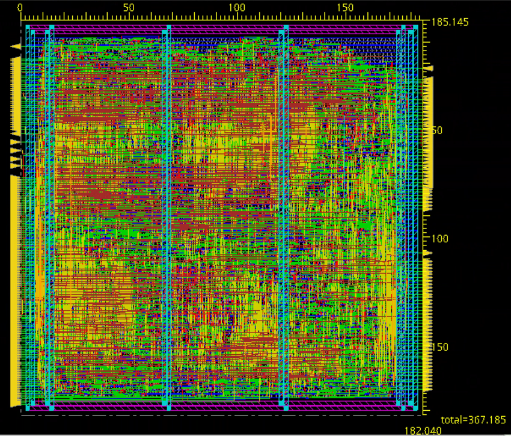
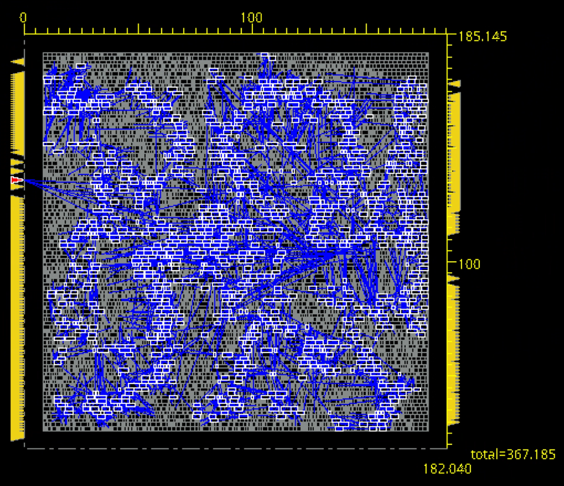
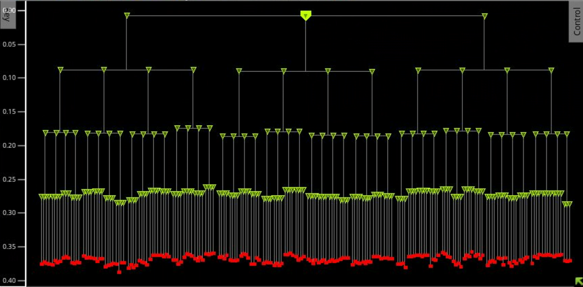
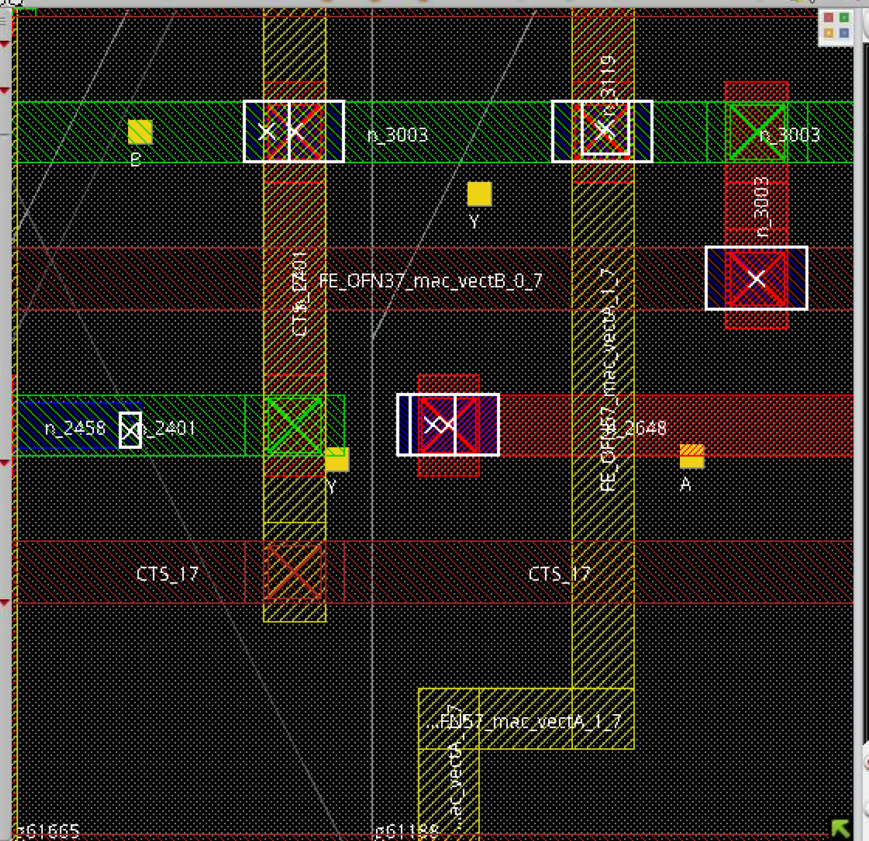
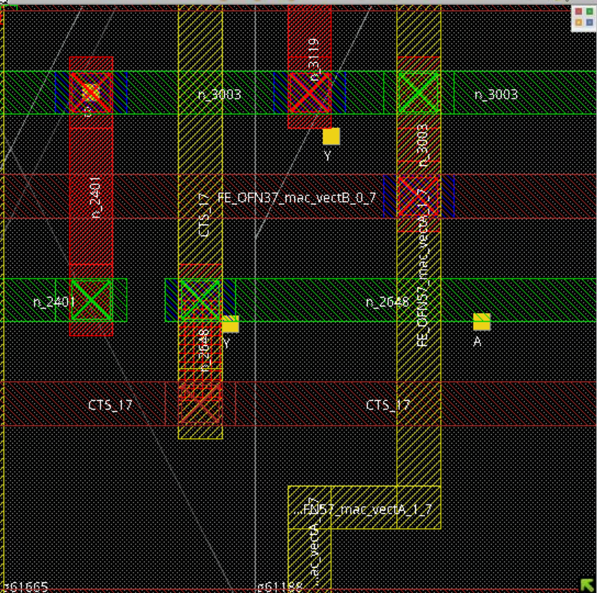
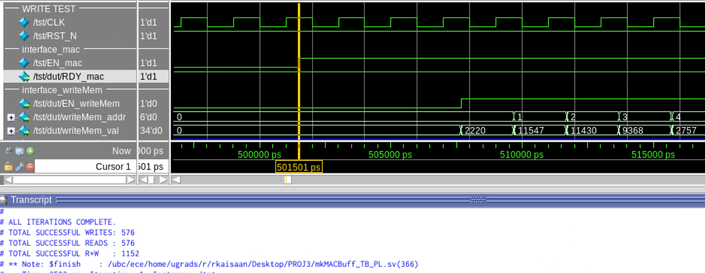
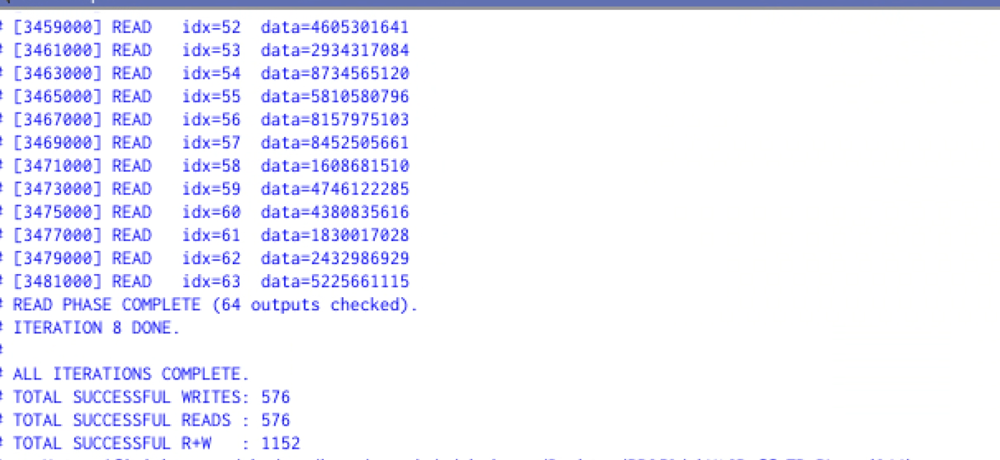

# DNN Dot-Product Accelerator | RTL-to-Layout Implementation

An end-to-end digital IC implementation project developed for **ELEC 402 at the University of British Columbia**. The project implements a dot-product accelerator in SystemVerilog, verifies its behavior against a reference model, and takes the design through **Cadence Genus synthesis and Cadence Innovus place-and-route**, followed by physical checks and timing-aware post-layout simulation.

The design uses four parallel 16-bit multipliers to compute dot products and provides a 64-entry result-memory interface. This README focuses on the **implementation flow and supporting evidence**, rather than a detailed walkthrough of the RTL.

*Final routed layout. The reported floorplan dimensions are 185.515 × 182.040 µm.*

## Results at a glance

| Metric | Reported result |
| --- | ---: |
| Nominal evaluated clock | **500 MHz** (2.0 ns period) |
| Synthesized standard-cell area | **16,828.161 µm²** |
| Final layout footprint | **33,703.7958 µm²** (185.515 × 182.040 µm) |
| Final setup slack | **+457 ps** |
| Final hold slack | **+5 ps** |
| Final DRC violations | **0** |
| Final connectivity violations | **0** |
| Post-layout test workload | **9 iterations; 576 writes + 576 reads** |
| Post-layout functional checks | **1,152 checks reported passing** |

*Area figures refer to different quantities: mapped standard-cell area versus overall post-layout floorplan footprint. Timing slacks are the final reported implementation values, not a sign-off claim for fabrication.*

## Functional verification

The SystemVerilog testbench checks functional behavior using an independent reference computation:

- During each write/fill phase, compute a reference dot product for accepted input pairs and retain the expected **34-bit** result by memory address.
- During block-read/stream operation, compare valid returned data against the expected result for the corresponding address.
- Exercise all **64 result-memory addresses**, including intermittent `EN_mac` assertion patterns, and check read/write sequencing and valid-data alignment.
- Use randomized 16-bit operands to exercise the datapath.

The functional and post-layout testbenches are separate, allowing the latter to account for propagated delays and revised reset/input timing.

## Synthesis and physical implementation

The implementation flow used **Cadence Genus** for synthesis and **Cadence Innovus** for floorplanning, placement, clock-tree synthesis (CTS), routing, physical verification, and timing analysis, with the **GPDK45** educational technology/library environment.

### Timing progression

| PnR stage | Setup slack | Hold slack |
| --- | ---: | ---: |
| Pre-placement | +158 ps | −436 ps |
| Post-placement / pre-CTS | −10 ps | −433 ps |
| Post-CTS | +27 ps | +16 ps |
| Post-route | +465 ps | +6 ps |
| Final | **+457 ps** | **+5 ps** |

The reports document how setup and hold behavior changed throughout implementation, including hold violations before CTS and positive reported slack at the final stage. See the original timing reports in `pnr/report_files/` when added to the repository.

### Clock-tree synthesis

*Clock tree highlighted in the Innovus layout.*

The CCOpt report describes a **four-level buffered clock tree** driving **755 positive-edge flip-flop sinks**, using **253 clock buffers**. The reported setup-late clock skew is **32 ps**, with **zero reported clock-tree electrical violations**. These numbers are specific to the tool's analyzed conditions.

Additional CCOpt visualization

## Physical verification and DRC closure

Routing initially completed without DRC or connectivity violations. Filling remaining standard-cell gaps eliminated the checked gap conditions but introduced reported physical-rule/connectivity violations. The implementation flow then used `ecoRoute` to repair the affected routing.

| Before correction | After `ecoRoute` |
| --- | --- |
|  |  |

*Example of a filler-related metal-short violation and the corrected geometry.*

The **final physical checks reported zero DRC violations and zero connectivity violations**. This describes the checks executed in the academic Innovus flow; it is not a foundry sign-off or manufacturing qualification.

## Post-layout verification

A separate SystemVerilog testbench exercised the timing-annotated post-layout implementation. The testbench increased reset duration for initialization under delays and adjusted input stimulus timing to model the input-delay constraint (one quarter of the 2.0 ns period, or 0.5 ns).

*Post-layout waveform showing timing offsets relative to clock edges.*

Across **nine test iterations**, the testbench exercised **576 writes and 576 reads**, corresponding to **1,152 reported checks**. One iteration used continuously asserted `EN_mac`; the others varied the enable over time. The report records that the checked operations passed.

*Concluding simulation evidence from the project report.*

## Repository guide

The submitted project archive contains the following original files and artifacts. If adopting this README in a new repository, preserve or reorganize these files and update the links to match:

| Materials | Original archive location |
| --- | --- |
| Accelerator RTL | `SystemVerilog/RTL/mkMACBuff.sv` |
| Multiplier module | `SystemVerilog/Multiplier module/multiplier_800M_16b.sv` |
| Functional testbench | `SystemVerilog/Testbench for functional verification/mkMACBuff_TB.sv` |
| Post-layout testbench | `SystemVerilog/Testbench for post-layout simulation/mkMACBuff_TB_PL.sv` |
| Genus scripts, constraints, QoR | `Synthesis/` |
| Innovus flow script | `pnr/tcl_files/runPNR.tcl` |
| Timing and clock-tree reports | `pnr/report_files/` |
| DRC/connectivity reports | `pnr/violations_output/` |
| Screenshots extracted from report | `images/` |

## Scope and limitations

- **Academic implementation:** This is an educational RTL-to-layout project using GPDK45 and Cadence EDA tools, not a fabricated silicon prototype.
- **Tool dependencies:** Reproducing the exact implementation requires compatible licensed tools, technology files, standard-cell libraries, and configuration; scripts may include paths specific to the original UBC environment.
- **Deliverables:** The available project archive contains RTL, testbenches, synthesis/physical-design scripts, reports, and screenshots. **A final GDSII file is not included** in the available archive; the repository should not imply otherwise.
- **Verification scope:** Randomized reference-model checking and SDF-annotated post-layout simulation provide evidence for the exercised behaviors. They are not exhaustive formal proof.
- **Timing and physical checks:** Results are from the documented educational flow and its analyzed corners and checking rules; they are not foundry sign-off results.
- **Licensing:** Before publishing any generated netlist, SDF, design database, or technology-dependent output, confirm redistribution rights. Avoid committing proprietary PDK/library contents or licensed EDA collateral.

## Author

**Kaisaan (Keefee) Rahman**  
University of British Columbia · ELEC 402
